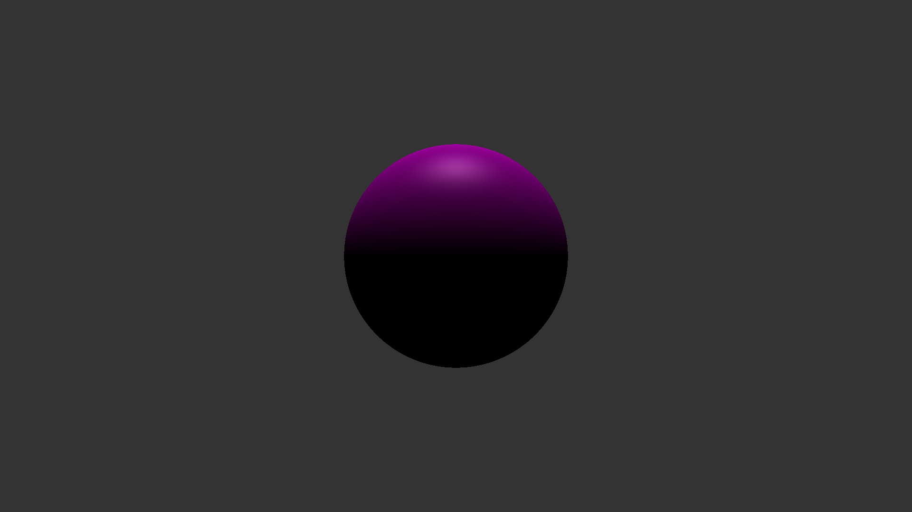
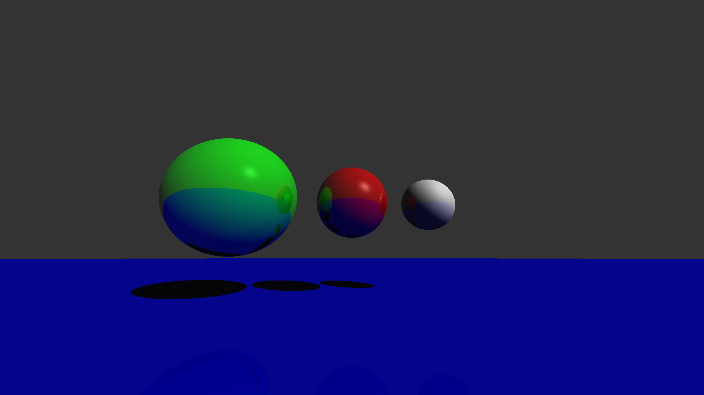
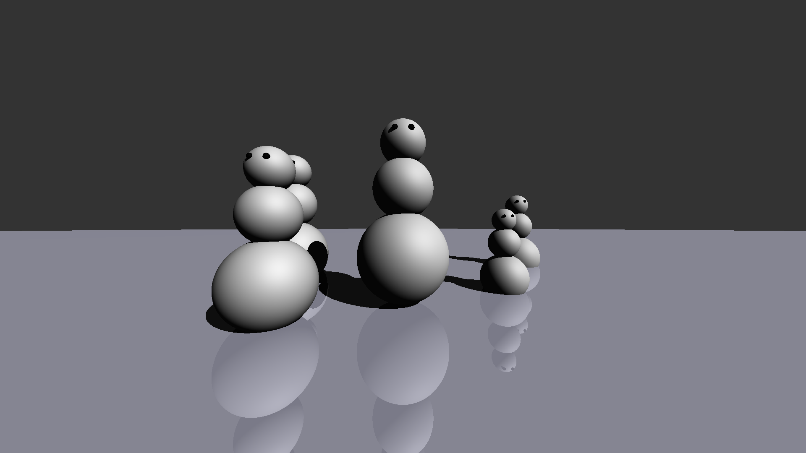
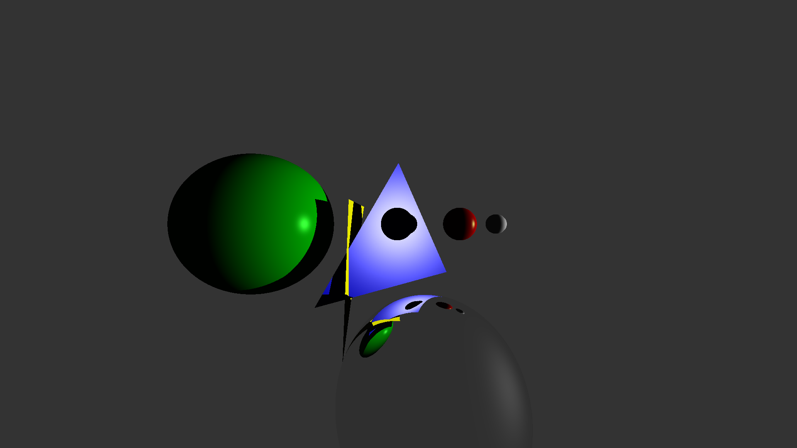
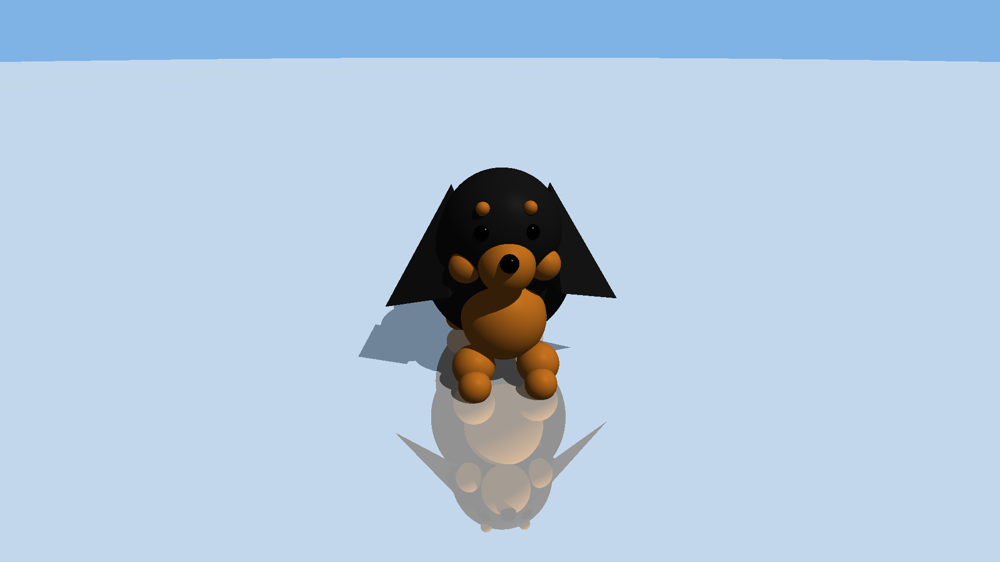

# CS455 Ray Tracer

An educational C++ ray tracer created for CS455. The project includes spheres,
planes, triangles, polygons, Phong shading, shadows, reflections, and several
sample scenes.

## Requirements

- CMake 4.1 or newer
- A C++20-compatible compiler

## Build

```powershell
cmake -S . -B build
cmake --build build
```

The executable is created at `build/CS455_RayTracer.exe` on Windows.

## Render a scene

Run the executable and choose a scene from the interactive prompt:

```text
Select a scene to render:
0. Exit Program
1. Pgm5 Scene 1 (Purple Sphere)
2. Pgm5 Scene 2 (4 Colored Spheres)
3. Pgm5 Scene 3 (Snowmen)
4. Pgm6 Scene 1 (Reflective Sphere & Triangles)
5. Pgm6 Scene 2 (More Spheres & Triangles)
6. Flapjack Scene (Custom)
```

The prompt accepts optional output flags:

- `6` renders the custom scene using the default output format.
- `6 -png` writes a PNG image.
- `6 -o render.png` writes to a custom filename.

## Sample renders

The following renders are included from the `output/NEW` folder.

| Scene 5-1 | Scene 5-2 | Scene 5-3 |
|---|---|---|
|  |  |  |

| Scene 6-1 | Scene 6-2 | Scene 6-3 |
|---|---|---|
|  |  |  |

Other generated render files are intentionally ignored by Git.

## Project structure

- `main.cpp` - scene definitions, ray tracing, shading, and the interactive renderer
- `Object3D.h`, `Sphere.h`, `Plane.h`, `Triangle.h`, `Polygon.h` - scene geometry
- `Material.h` - material properties
- `Ray.h`, `Vec3.h` - ray and vector math
- `stb_image_write.h` - single-header PNG writing dependency
- `CMakeLists.txt` - CMake build configuration
